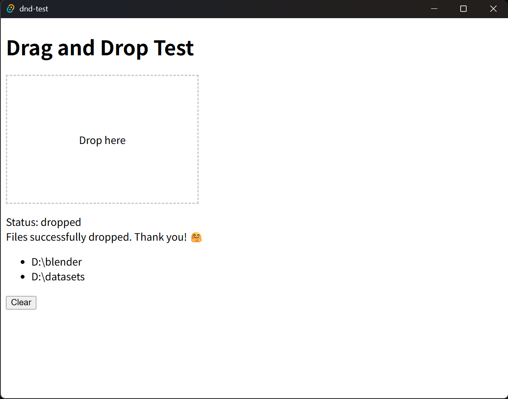

# My Sandbox for Cross-Platform Drag & Drop

## About

Implementing file drag-and-drop functionality in cross-platform desktop applications is extremely hard.
This repository serves as a personal sandbox for experimenting with various frameworks and approaches.

## Frameworks

| Status          | Framework      | Code |
|-----------------|----------------|------|
| ✅ Implemented | Avalonia UI    | [dotnet-avalonia/Views/MainWindow.axaml.cs](dotnet-avalonia/Views/MainWindow.axaml.cs) |
| ✅ Implemented | Electron       | [electron/renderer.js](electron/renderer.js) |
| ✅ Implemented | Iced           | [rust-iced/src/main.rs](rust-iced/src/main.rs) |
| ✅ Implemented | Tauri          | [tauri/src/routes/+page.svelte](./tauri/src/routes/+page.svelte) |
| 📝 TODO        | MAUI           | |
| 📝 TODO        | Flutter        | |

## Screenshot

## License

The Unlicense.
